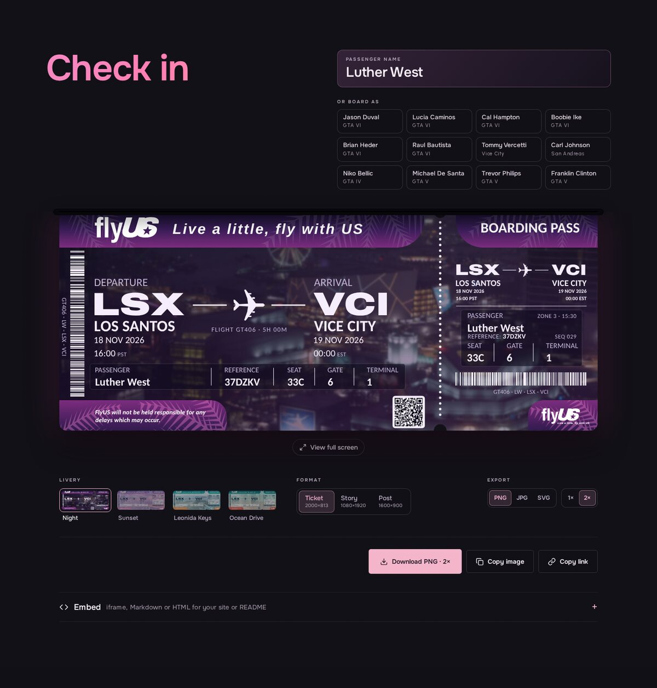
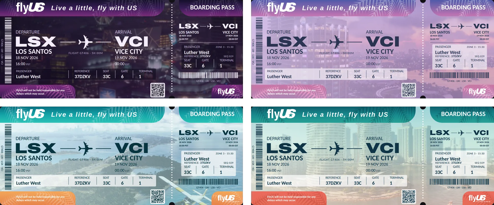
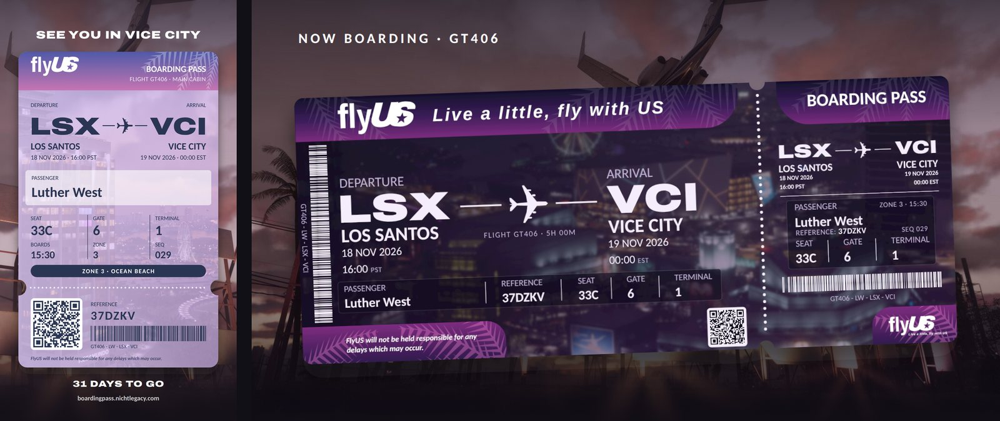
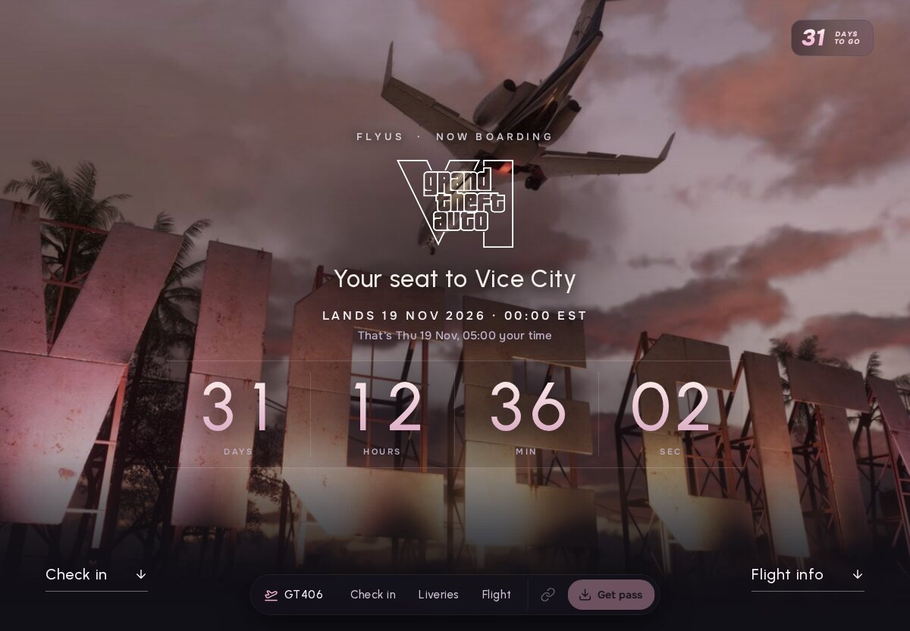
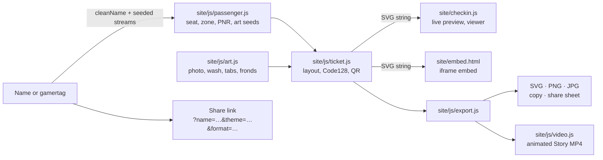

<div align="center">


# Flight GT406

**A fan-made FlyUS boarding pass generator for flight GT406, Los Santos to Vice City, landing on GTA VI release day.**
<br>
Type a name or gamertag and the ticket prints. No account, no backend, no tracking: the pass is drawn in your browser.

[](https://boardingpass.nichtlegacy.com)
[](https://github.com/nichtlegacy/boarding-pass-ls-vc/actions/workflows/pages.yml)
[](site/js/)
[](site/)
[](#tests)
[](LICENSE)

[Website](https://boardingpass.nichtlegacy.com) • [Overview](#overview) • [Features](#features) • [Screenshots](#screenshots) • [Quick start](#quick-start) • [How it works](#how-it-works) • [Privacy](#privacy) • [Credits](#credits-and-third-party-assets)

<a href="https://boardingpass.nichtlegacy.com"></a>

</div>

## Overview

Ahead of the GTA VI release, boarding passes for a flight GT406 from Los Santos to Vice City went around on X, and the replies filled up with people dropping their names and asking for a ticket of their own.

This site prints that ticket for anyone, at once. The name is the seed: seat, cabin, boarding zone, booking reference, barcodes and the art on the pass all follow from it, so the same name always gets the same ticket and a link is enough to share it. The flight leaves Los Santos at 16:00 PST on 18 November 2026 and lands in Vice City at 00:00 EST on 19 November 2026, when the game is out.

The project stays deliberately:

- **static** — plain HTML, CSS and ES modules under `site/`, no bundler; the deploy only stamps module URLs with the commit.
- **local** — the ticket and every export are made in the browser; there is no server-side code at all.
- **deterministic** — no `Math.random` in the ticket; one name, one seat, today and next year.

> Unofficial fan project. Not affiliated with Rockstar Games or Take-Two Interactive — see [Disclaimer](#disclaimer).

## Features

- **Same name, same seat.** Every field is drawn from its own seeded stream of the lower-cased name. The draw order is frozen as version 1, so a shared link still opens the same pass later.
- **First Class**: about 3 in 100 names are upgraded and get foil tabs and a seal. A few names get special treatment.
- **Five liveries**: Night (the default), Sunset, Leonida Keys and Ocean Drive, each printed over its own GTA VI screenshot under a livery wash, plus Goodtime State, drawn over the illustrated art of Rockstar's Vice City Collection with its stickers (animated on the page, a fixed key pose in exports). The liveries section shows your pass in all five.
- **Three formats**: the landscape ticket at 2000×813 (transparent PNG, die-cut corners), a 1080×1920 Story and a 1600×900 Post with the ticket on a scene.
- **Exports**: PNG at 1× or 2×, JPG, and SVG with the ticket fonts embedded. Copy image where the browser supports it; on phones the main button opens the system share sheet.
- **Animated Story**: in Goodtime State, the Story also exports as MP4 with the stickers moving: 1080×1920, H.264 at 30 fps, a 7.2-second seamless loop, no audio, ready to upload to Instagram, TikTok and X. Encoded in the browser with WebCodecs; browsers without an H.264 encoder do not show the option.
- **Share links and a real QR code**: `?name=&theme=&format=` reopens the exact pass, and the QR code on the ticket links to it. Two Code128 barcodes carry the route and booking data.
- **Embeds**: copy-ready iframe, Markdown and HTML (`<picture>` with light and dark) snippets; the iframe serves [`embed.html`](site/embed.html).
- **Full-screen view**: on a portrait phone the landscape ticket turns on its side, like holding the real thing.
- **Countdown and departures board**: the landing page counts down to the GTA VI release in the visitor's time zone (15 regional windows from store listings, local midnight as an estimate elsewhere) in large gradient digits, and a split-flap board moves GT406 from on time to boarding, final call, departed and arrived.
- **Intro and motion**: the GTA VI mark draws itself on first visit; any input fast-forwards it. Under `prefers-reduced-motion` the intro, flaps, tilt and scroll effects are skipped and the page is static.

## Screenshots

<div align="center"><br><sub>One name, four liveries · Night, Sunset, Leonida Keys, Ocean Drive</sub></div>

<br>

<div align="center"><br><sub>Story 1080×1920 (Sunset) · Post 1600×900 (Night)</sub></div>

<details>
<summary><strong>Landing page</strong></summary>
<br>
<div align="center"></div>
</details>

## Quick start

Nothing to install: open **[boardingpass.nichtlegacy.com](https://boardingpass.nichtlegacy.com)**.

To run it locally (any static file server works; ES modules need `http://`, not `file://`):

```bash
git clone https://github.com/nichtlegacy/boarding-pass-ls-vc.git
cd boarding-pass-ls-vc
python3 -m http.server 8000 --bind 127.0.0.1 --directory site   # http://localhost:8000
node scripts/selftest.mjs                                        # needs Node, no npm install
```

Expected: the landing page with the GTA VI title over the Vice City sign and the countdown; type a name under *Check in* and the pass prints. The self-test ends with `selftest ok: 2682 checks`.

### Share links

| Parameter | Values | Default |
|---|---|---|
| `name` | any name or gamertag; cleaned to Latin, Greek and Cyrillic, 24 characters at most | none: the ghost pass reads "Your name here" |
| `theme` | `night`, `sunset`, `keys`, `ocean` (`embed.html` also takes `auto`) | `night`; `auto` follows the host page's colour scheme |
| `format` | `ticket`, `story`, `post` | `ticket` on wide screens, `story` on narrow ones |

Example: `https://boardingpass.nichtlegacy.com/?name=Luther+West&theme=keys&format=post`

### Asset scripts

Everything under `site/` is committed as deployed, apart from the version stamp on module URLs. The scripts only regenerate committed assets and are never deployed:

| Script | Produces | Needs |
|---|---|---|
| [`scripts/fonts.sh`](scripts/fonts.sh) | `site/fonts/*.woff2` and `OFL.txt`: download, instance, subset, rename, coverage check | Python 3, network |
| [`scripts/render.sh`](scripts/render.sh) | the link card `site/og.jpg` (and its `?v=` hash in `index.html`), `.github/images/social-preview.png`, favicon PNGs and `favicon.ico` | Playwright's headless Chromium, Pillow |
| [`scripts/stickers.py`](scripts/stickers.py) | `site/img/sticker-*-sheet.webp` and `site/js/sticker-frames.js`: the animated stickers as sprite sheets with their frame timings, for the MP4 export | Pillow |
| [`scripts/wordmark.py`](scripts/wordmark.py) | `site/js/wordmark.js`, the FlyUS wordmark outlined from Archivo | fontTools, skia-pathops |
| [`scripts/stamp.mjs`](scripts/stamp.mjs) | the deployed copy of `site/` with `?v=<commit>` on local scripts, imports and stylesheets (run by the workflow) | Node |
| [`scripts/og.html`](scripts/og.html) | the template `render.sh` screenshots | a local server at the repo root |
| [`scripts/lab.html`](scripts/lab.html) | nothing: every format, livery and test name in one grid for visual checks (`?name=`, `theme=`, `format=`, `all`) | a local server at the repo root |

The social preview has no API: upload `.github/images/social-preview.png` under *Settings → General → Social preview* after a re-render.

## How it works



- **Deterministic, not random.** Each field draws from its own stream (FNV-1a of the name plus a salt, into mulberry32), so adding a field later never moves an existing seat. Odds, seat maps, the PNR alphabet and the draw order are frozen for version 1; golden values in the self-test guard them.
- **One SVG for everything.** The preview, the full-screen view, the embed and every export come from the same `buildTicketSVG()` call. Exports embed the five ticket faces and the photos as data URIs, so the SVG looks the same in any viewer, and PNG/JPG are drawn from that SVG onto a canvas. The animated Story draws the Story without its stickers once, then paints each sticker frame from its sprite sheet on top, 216 times, into a WebCodecs `VideoEncoder` and [mp4-muxer](https://github.com/Vanilagy/mp4-muxer).
- **Drawn over real shots.** The ticket follows the layout of Vinewood Motors' original passes (see [Credits](#credits-and-third-party-assets)). Shapes, tabs, fronds and the FlyUS wordmark are generated in code; the backdrop is a GTA VI screenshot per livery.
- **Loaded when needed.** The ticket engine and its fonts load on idle after the intro, when the check-in comes into view, or at once on a share link.

Deployed to GitHub Pages by [`pages.yml`](.github/workflows/pages.yml) on every push to `main` that touches `site/`. The workflow first checks that every local `src`, `href` and meta link in the HTML points to a file that exists, then uploads a copy of `site/` in which [`scripts/stamp.mjs`](scripts/stamp.mjs) has added `?v=<commit>` to every local script, module import and stylesheet. Pages caches each file for ten minutes on its own, so without the stamp a browser could pair a cached module from the last deploy with a new one and fail to load the ticket engine.

## Tests

| Check | Result | Reproduce |
|---|---|---|
| Golden tickets (seat, zone, PNR, sequence, initials, art seed) for fixed names | frozen v1 values | `node scripts/selftest.mjs` |
| 20,000 synthetic names | First ≈3 %, Extra Legroom ≈12 %, Main ≈85 %, all 172 seats reachable, no row 13 | same |
| Name cleaning, slugs, share URLs, QR text, file names, countdown states, regional unlock times | pass | same |
| Code128 decode, QR contrast ≥ 7:1 per livery | pass | same |
| SVG output rules for every format × livery × awkward name, name fitting | pass | same |
| Animated Story: sticker layout, seamless loop timing, every frame shown | pass | same |

Total: `selftest ok: 2682 checks`, plain Node with `node:assert`, no dependencies.

## Project structure

```text
site/                    the whole website, deployed as is
├── index.html           landing page, hero, check-in, liveries, flight board, icon sprite
├── app.css              page styles and tokens
├── app.js               intro, hero scrub, countdown, departures board, dock, reveals, toasts
├── checkin.js           check-in flow, preview, export buttons, URL sync, viewer, embed snippets
├── embed.html           iframe embed of a single pass
├── js/                  ticket engine: passenger, themes, codes, ticket, art, export, wordmark
│   └── vendor/          qrcodegen.js (Nayuki, MIT), mp4-muxer.js (Vanilagy, MIT)
├── img/                 hero, ticket, card and scene photos (Rockstar screenshots), GTA VI logo, swatches
└── fonts/               self-hosted woff2: OFL subsets only
scripts/                 asset generators, self-test, og template and visual lab (not deployed)
.github/workflows/       pages.yml
```

## Privacy

No cookies, no analytics, no backend. The ticket and every export are made in your browser; the page loads only its own files from `boardingpass.nichtlegacy.com`.

- The address bar mirrors the current ticket via `history.replaceState`, which sends nothing anywhere. The name reaches a server only when someone opens a link that contains it; GitHub Pages then sees the URL like any page request.
- The one thing stored is a `sessionStorage` flag that shortens the intro on a second visit in the same tab.
- *Post on X* in the share toast opens `x.com` only when you click it.

## Known limitations

- Link previews show the generic card, not your ticket: the site is static and crawlers do not run JavaScript. Share the image for the full effect.
- No Apple Wallet or Google Wallet pass: those need a signing server.
- Names in scripts other than Latin, Greek and Cyrillic are left out, because the ticket font does not cover them and the pass should look the same everywhere.
- Copy image and the share sheet depend on browser support; the buttons hide where it is missing.

## Credits and third-party assets

The ticket design follows the FlyUS GT406 boarding passes that Vinewood Motors made by hand for its followers on X; this site lets everyone print their own. FlyUS is a fictional airline from the Grand Theft Auto series. The page's visual language follows [gtavicentre.com](https://gtavicentre.com).

| Asset | Files | Source | Licence |
|---|---|---|---|
| Background photos | `site/img/{hero,ticket,card,scene}-*.jpg`, swatches, `site/og.jpg` | Rockstar Games screenshots, obtained via [gtavicentre.com](https://gtavicentre.com) | © Rockstar Games, used as fan art |
| Goodtime State art and stickers | `site/img/{ticket,card,scene-*}-goodtime.jpg`, `site/img/sticker-*.webp` (and the sprite sheets cut from them) | Rockstar Games' *The Goodtime State* Vice City Collection, via [gtavicentre.com](https://gtavicentre.com) | © Rockstar Games, used as fan art |
| Grand Theft Auto VI logo | `site/img/gta-vi.png` | Rockstar Games | © / ™ Rockstar Games |
| Urbanist | `site/fonts/urbanist-500.woff2` | [google/fonts](https://github.com/google/fonts/tree/main/ofl/urbanist) | SIL OFL 1.1 |
| Onest | `site/fonts/onest-var.woff2` | [google/fonts](https://github.com/google/fonts/tree/main/ofl/onest) | SIL OFL 1.1 |
| GT406 Sans (renamed Carlito subset) | `site/fonts/carlito-*.woff2` | [google/fonts](https://github.com/google/fonts/tree/main/ofl/carlito) | SIL OFL 1.1, Reserved Font Name "Carlito" |
| Archivo Expanded (also the wordmark outlines) | `site/fonts/archivo-expanded-900.woff2` | [google/fonts](https://github.com/google/fonts/tree/main/ofl/archivo) | SIL OFL 1.1 |
| Arimo Bold Italic | `site/fonts/arimo-700i.woff2` | [google/fonts](https://github.com/google/fonts/tree/main/ofl/arimo) | SIL OFL 1.1 |
| QR encoder | `site/js/vendor/qrcodegen.js` | [nayuki/QR-Code-generator](https://github.com/nayuki/QR-Code-generator) | MIT |
| MP4 muxer | `site/js/vendor/mp4-muxer.js` (5.2.2) | [Vanilagy/mp4-muxer](https://github.com/Vanilagy/mp4-muxer) | MIT |
| Icon shapes | sprite in `site/index.html` | after [Lucide](https://lucide.dev) | ISC |

The OFL fonts ship with [`site/fonts/OFL.txt`](site/fonts/OFL.txt); [`site/fonts/README.md`](site/fonts/README.md) documents subsets and the Carlito rename.

## License

[MIT](LICENSE) for the code. The licence does not cover the Rockstar Games screenshots, the Grand Theft Auto VI logo or the original ticket design; the OFL fonts keep their own licence.

## Disclaimer

**Flight GT406 is an unofficial, non-commercial fan project.** It is not affiliated with, endorsed by, sponsored by, or connected to Rockstar Games or Take-Two Interactive in any way.

"Grand Theft Auto", "GTA VI", "Vice City", "Los Santos", "FlyUS" and related marks are trademarks of their respective owners and are used here only to describe the game this fan project celebrates. The screenshots and the GTA VI logo belong to Rockstar Games and are used here as fan art.

<p align="center"><sub>Built by <a href="https://github.com/nichtlegacy">nichtlegacy</a></sub></p>
